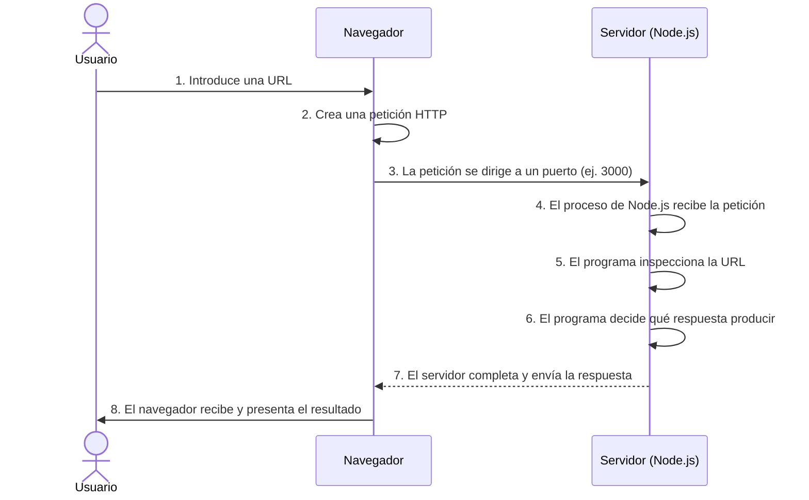

# course-progress-evidence-01-07

Paquete de evidencia para el diagnóstico acumulativo 7 en 1.
Generado automáticamente — completa las secciones marcadas con [COMPLETAR] antes de ejecutar el prompt.

## Metadata

* studentId: alexisgonzalez.itsu@gmail.com
* promptVersion: ITSU-CHECKPOINT-01-07-1.0
* rubricVersion: BACKEND-01-07-R1
* generatedAt: 2026-10-12T17:23:10.544Z (EXECUTED_NOW)
* repoRoot: desarrollo-backend
* commit: 68c2867 (EXECUTED_NOW)
* repositorioRemoto: https://github.com/alexisegm/desarrollo-backend.git (EXECUTED_NOW) — verifica que sea TU repositorio antes de continuar
* modeloUtilizado: [COMPLETAR después de ejecutar el prompt]

### Contexto de git (informativo, EXECUTED_NOW)

El curso se trabaja en computadoras compartidas: el historial local puede
estar incompleto o pertenecer a otra sesión sin que falte trabajo real.
Este contexto NO es evidencia requerida — la evidencia son los archivos
del repositorio remoto del estudiante y sus respuestas. La ausencia de
commits aquí no debe interpretarse como evidencia faltante.

```text
68c2867 class-07-submission
cffbfa9 Subida clase-08
5f1f54d fix: resolver INC-701 e INC-702 con validaciones y pruebas de regresion
698847c feat(learn): implementacion general para Entrega 05B
73165e3 chore: entrega clase 06
0b3b911 feat: creacion de enpoint de historial de solicitudes
d1bc410 fix: return empty array for valid empty collection
39de697 chore: setup inicial de environment clase 06
```

## Evidencia por clase

Los archivos listados existen en el repositorio (FOUND). Un archivo de salida guardado, como validation-evidence.txt, es TEXTO: demuestra que se guardó, no que se ejecutó (NOT_VERIFIED como ejecución).

### Clase 01 — Fundamentos de backend

* FOUND: activities\class-01\README.md
* FOUND: activities\class-01\broken-servers\README.md
* FOUND: activities\class-01\broken-servers\fault-1.js
* FOUND: activities\class-01\broken-servers\fault-2.js
* FOUND: activities\class-01\broken-servers\fault-3.js
* FOUND: activities\class-01\broken-servers\fault-4.js
* FOUND: activities\class-01\broken-servers\fault-5.js
* FOUND: activities\class-01\broken-servers\fault-6.js
* FOUND: activities\class-01\broken-servers\package.json
* FOUND: activities\class-01\src\server.js

Extracto de activities\class-01\README.md (redactado automáticamente):

```text
# Clase 1: Fundamentos y Primer Servidor en Node.js

## 1. Instrucciones para ejecutar
Para iniciar el servidor, abre la terminal en la carpeta raíz del proyecto y ejecuta el siguiente comando:
```bash
node src/server.js
```
El servidor estará escuchando en el puerto 3000. Puedes probar su funcionamiento visitando `http://localhost:3000` en tu navegador web.

## 2. Diagrama del recorrido de una petición
A continuación se ilustra el ciclo de vida de una petición HTTP básica:



## 3. Reporte de Falla (Laboratorio): fault-1.js

[... 51 líneas más]
```

### Clase 02 — HTTP y contratos

* FOUND: activities\class-02\README.md
* FOUND: activities\class-02\ai-usage.md
* FOUND: activities\class-02\comparison.md
* FOUND: activities\class-02\lite-analysis.md
* FOUND: activities\class-02\lite-api\README.md
* FOUND: activities\class-02\lite-api\package-lock.json
* FOUND: activities\class-02\lite-api\package.json
* FOUND: activities\class-02\lite-api\server.js
* FOUND: activities\class-02\project\README.md
* FOUND: activities\class-02\project\docs\http-contract.md
* FOUND: activities\class-02\project\package-lock.json
* FOUND: activities\class-02\project\package.json
* … 7 archivo(s) más con el mismo patrón

Extracto de activities\class-02\project\docs\http-contract.md (redactado automáticamente):

```text
# Contrato HTTP — Request API Full

> El contrato es la promesa que hace tu API; el código es la manera de cumplirla.
> Si primero escribes el código y después el contrato, estarás documentando lo que salió, no
> lo que decidiste.

## Recurso

Una solicitud ('request') representa un ticket de mantenimiento o reporte de falla de infraestructura dentro del sistema, indicando el problema, su prioridad y su estado de resolución.


### Forma del recurso

| Campo       |     Tipo  | Obligatorio | Quién lo asigna |                       Notas                        |
| ------------|    ------ | ----------- | --------------- |                      -----                         |
| `id`        |   Number  |    Si       |  Servidor       |         Autogenerado, único y secuencial           |
| `title`     |   String  |    Si       |  Cliente        | No puede estar vacío ni compuesto solo de espacios.|
|`description`|   String  |    No       |  Cliente        |            Detalle adicional del problema          |
| `status`    |   String  |    Si       |  Servidor       |    Por defecto se asigna como 'open' al crear.     |
| `priority`  |   String  |     Si      |  Cliente        |         Puede ser 'low', 'medium' o 'high'         |

---

## Endpoint 1 — Listar solicitudes

| Elemento              |                           Valor                       |
| --------------------- |                           -----                       |
| Método                |                            GET                        |
| Ruta                  |                       `/requests`                     |
| Entrada               |             Ninguna requerida en esta iteración       |
[... 96 líneas más]
```

Extracto de activities\class-02\README.md (redactado automáticamente):

```text
# Clase 2: Diseño y Refactorización de APIs HTTP

Este repositorio contiene la resolución de las prácticas de backend enfocadas en el diseño, análisis y refactorización de APIs RESTFUL, manejando correctamente los métodos y códigos de estado HTTP bajo un contrato estricto.

## Estructura del Proyecto

El proyecto está organizado en dos fases, con sus respectivos recursos separados:

*   `/lite-api/`: Contiene la versión de código de un solo archivo (`server.js`), refactorizada a partir de un código defectuoso.
*   `/project/`: Contiene la "Request API Full", construida desde cero bajo una arquitectura de separación de responsabilidades (servidor, app, rutas y datos).
*   `lite-analysis.md`: Evidencia de las fallas de la API Lite previas a cualquier corrección.
*   `ai-usage.md`: Registro detallado de la asistencia de la IA, comandos utilizados y decisiones aceptadas/rechazadas.
*   `comparison.md`: Análisis reflexivo comparando las dimensiones de ambos proyectos.

## Instrucciones de Instalación y Ejecución

Ambos proyectos requieren Node.js (v18+) y funcionan en el puerto 3000. Es imprescindible detener un servidor (Ctrl + C) antes de levantar el otro.

**Para ejecutar API Lite:**

    cd lite-api
    npm install
    npm start

**Para ejecutar API Full:**

    cd project
    npm install
    npm start

[... 21 líneas más]
```

### Clase 03 — Recursos, estado y reglas

* FOUND: activities\class-03\ai-usage.md
* FOUND: activities\class-03\http-contract.md
* FOUND: activities\class-03\reflection.md
* FOUND: activities\class-03\resource-model.md
* FOUND: activities\class-03\test-matrix.md
* FOUND: activities\class-03\transition-map.md
* FOUND: activities\class-04\test-matrix.md

Extracto de activities\class-03\resource-model.md (redactado automáticamente):

```text
Nombre del recurso
Solicitud: es la entidad conceptual que el sistema administra.Existe aunque nadie la este consultando.

Propiedades
|Propiedad |	Tipo |	Ejemplo |
|:---|:---|:---|
|id | Numero | 42|
|title | String | "Projector failure" |
|description | String | "the projector does not display an image" |
|priority | String | "high" |
|status | String | "open" |
|createdAt | String ISO | "2026-08-24T18:30:00.000Z" |
|updatedAt | String ISO | "2026-08-24T18:30:00.000Z" |
Campos requeridos
La solicitud no puede existir sin un titulo, de forma obligatoria.

Campos opcionales
Como campos opcionales estan: description, priority (toma el valor medium por defecto) y status (su valor por defecto es open)

Campos generados por el servidor
id, createdAt y updatedAt. No se aceptan del cliente porque la entidad no puede depender de del cliente y las fechas de modificacion deben ser controladas por el sistema

Estados permitidos
open, in_progress, resolved, closed, cancelled

Reglas
* Toda solicitud siempre tiene un ID

* Toda solicitud siempre tiene un titulo 

[... 20 líneas más]
```

Extracto de activities\class-03\ai-usage.md (redactado automáticamente):

```text
# AI usage - Clase 3

## What I asked for
* Solicité asistencia, exclusivamente después de la fase de diseño (tras el tag `class-03-design`), para migrar la estructura del proyecto original a un formato modular (`modules/requests/`) sin romper el funcionamiento existente.
* Pedí apoyo para implementar la máquina de estados en el archivo `request-status.js` y para codificar las validaciones de los endpoints `POST`, `PATCH` y `GET`, asegurándome de que se respetaran las exclusiones (sin bases de datos ni métodos `DELETE`).
* Solicité una revisión de mi borrador manual para la decisión técnica (cancelar vs. borrar), buscando adaptarlo al formato estricto exigido por la rúbrica (Contexto, Opciones, Decisión y Consecuencias).

## What the AI proposed
* Propuso una reestructuración de rutas e importaciones para desacoplar la lógica HTTP del almacenamiento en memoria.
* Propuso el código para centralizar las reglas de negocio en `request-status.js`, incluyendo validadores como `isValidTransition`, `isTerminalStatus` y un validador opcional `isValidStatus`.
* Para los endpoints, propuso la implementación completa de filtros por estado y prioridad en el `GET`, y la lógica para devolver errores `409` en el `PATCH` ante transiciones inválidas.
* Propuso una reestructuración de mi texto de decisión técnica para que encajara visualmente en los bloques requeridos por la rúbrica.

## What I accepted
* Acepté la arquitectura modular propuesta para la máquina de estados, ya que aísla exitosamente las reglas de negocio de los manejadores de rutas (cohesión).
* Acepté el uso del validador opcional `isValidStatus` tras cuestionar su apego al material de la clase; confirmé que cumple con la distinción entre "validar la forma" (error 400) y "proteger la regla" (error 409).
* Acepté la reestructuración de la nota de decisión técnica porque respetó íntegramente mi argumento base sobre la ganancia de auditoría frente a la pérdida de simplicidad.

## What I changed or rejected
* **Comentarios y mensajes de commit:** Rechacé los comentarios excesivos en el código de la máquina de estados generado por la IA; limpié el código para mantenerlo conciso y ajusté los mensajes de los commits a mi propio formato y flujo de trabajo.
* **Separación estricta de fases:** Rechacé la intervención de la IA en la creación inicial de los contratos, mapa de transiciones y matriz de pruebas (Fase 1), garantizando que el diseño original fuera completamente de mi autoría antes del primer commit evaluado.

## How I verified it
* Ejecuté pruebas directas en la terminal con `curl` para confirmar que las importaciones y la nueva estructura de carpetas levantaran el servidor sin errores (`node src/server.js`).
* Sometí el endpoint `PATCH` a pruebas de estrés manuales, confirmando empíricamente que intentar saltar de `open` a `closed` devolvía exactamente el error HTTP 409 con el código `INVALID_STATUS_TRANSITION` estipulado en el diseño.

## What I still do not understand
* Si bien comprendo el flujo de las solicitudes, sus transiciones, la separación de reglas y el concepto general de idempotencia, siento que necesito profundizar mucho más en las implicaciones técnicas de cada uno de estos temas. Considero que son conceptos sumamente complejos para ser asimilados de manera ideal o completa dadas las actuales limitaciones de tiempo, sin el apoyo directo de herramientas de acompañamiento como las IAs. Entiendo y asumo la responsabilidad de buscar la manera de introducirnos de manera personal en la adquisición de este conocimiento, pero la combinación de una alta exigencia técnica y el tiempo limitado dificultan enormemente la tarea de dominar estas arquitecturas de forma autodidacta en principio.
```

### Clase 04 — PostgreSQL y persistencia

* FOUND: activities\class-04\ai-usage.md
* FOUND: activities\class-04\data-model.md
* FOUND: activities\class-04\error-map.md
* FOUND: activities\class-04\persistence-contract.md
* FOUND: activities\class-04\query-matrix.md
* FOUND: activities\class-04\reflection.md
* FOUND: activities\class-04\test-matrix.md
* FOUND: activities\class-04\transaction-plan.md
* FOUND: activities\class-06-starter\scripts\seed.js
* FOUND: activities\class-07-starter\scripts\seed.js
* FOUND: activities\class-08\scripts\seed.js

Extracto de activities\class-04\ai-usage.md (redactado automáticamente):

```text
# AI Usage

## My design before using AI
Quiero dejar súper claro que toda la idea inicial y el diseño los armé a mano, sin ayuda de ninguna IA[cite: 4]. Yo mismo pensé, redacté y armé los seis documentos del proyecto (`data-model.md`, `persistence-contract.md`, `query-matrix.md`, `transaction-plan.md`, `error-map.md`, `test-matrix.md`). Hice mi commit `class-04-design` con todo esto listo antes de hacerle la primera pregunta al chat.

## What I asked the AAI
Siguiendo las reglas de la materia, solo le pedí ayuda para cosas muy puntuales:
1. Que le diera una revisada a mi estructura de base de datos, las reglas que le puse y a mi traductor de datos (el mapper).
2. Que se fijara si estaba metiendo la pata con SQL inseguro (como concatenar textos directo) y si me estaba olvidando de cerrar conexiones en el código.
3. Que mirara cómo armé la lógica de la transacción para ver si se iba a quedar trabada, y que me sugiriera cómo probarla correctamente.
4. Que me explicara en palabras sencillas unos errores raros de PostgreSQL que me salieron y cómo era mejor manejarlos.

## What the AI proposed
* **La idea principal:** Me propuso crear una función de ayuda (un helper llamado `withTransaction`) para manejar las transacciones en un solo lugar, pidiéndole una conexión exclusiva a la base de datos usando `pool.connect()`.
* **Lo bueno:** Me asegura que guardar la solicitud y su historial ocurra al mismo tiempo (si falla uno, no se guarda nada) y garantiza que la conexión siempre se devuelva al terminar, pase lo que pase.
* **Lo malo:** Hizo que el código fuera un poco más enredado porque ahora tengo que andar pasándole la conexión manualmente desde el servicio hasta donde guardo los datos.

## What I accepted
Me pareció buena la idea del helper para las transacciones y también tomé su consejo de ordenar los errores por categorías (contrato, dominio, recurso, infraestructura).
* **Decisión:** Aceptar los cambios.
* **Documentación:** Me aseguré de que mis documentos de transacciones y errores reflejaran estos ajustes.
* **Verificación:** Probé todo en mi computadora usando mi matriz de pruebas y funcionó de maravilla.

## What I rejected or accepted
Fui muy estricto con la IA: le dije que no podía inventar cambiándome tablas, columnas, rutas o estados por detrás sin avisarme. También le frené explicaciones larguísimas y cualquier intento de meterme herramientas que no estábamos usando (como ORMs o `supabase-js`), obligándola a trabajar solo con el SQL puro y el contrato que ya habíamos definido.

## How I verified the result
No usé nada automático para probar Fui metiendo comando por comando en mi terminal con `curl` basándome en mi matriz de pruebas. Para estar seguro de que los datos no se borraban, tumbé el servidor de Express por completo y al volverlo a levantar vi que todo seguía ahí. También forcé un error a propósito para comprobar que la transacción de verdad daba marcha atrás (`ROLLBACK`) si algo salía mal.

## What I still do not understand
[... 1 líneas más]
```

### Clase 05 — Autenticación y autorización

* FOUND: activities\class-05\README.md
* FOUND: activities\class-05\ai-usage.md
* FOUND: activities\class-05\decision-log.md
* FOUND: activities\class-05\reflection.md
* FOUND: activities\class-05\validation-evidence.md — salida guardada, NOT_VERIFIED como ejecución
* FOUND: project\activities\class-05\access-matrix.md
* FOUND: project\activities\class-05\auth-contract.md
* FOUND: project\activities\class-05\threat-cases.md
* FOUND: project\scripts\validate-class-05.js

Extracto de project\activities\class-05\auth-contract.md (redactado automáticamente):

```text
# Contrato de autenticación — Request API v5

Documenta ANTES de implementar. Para cada endpoint: método, ruta, ¿público o
protegido?, body permitido, respuesta de éxito (código + forma) y CADA error
(código HTTP + `error.code`).

# Contrato de Autenticación

## POST /auth/register
- **Éxito**: Responde `201 Created` con el ID del usuario generado. No debe revelar hashes ni contraseñas.
- **Errores**: 
  - `409 Conflict` (código `ACCOUNT_CANNOT_BE_CREATED`) si el correo ya existe. Respuesta genérica.
  - `400 Bad Request` si se intentan enviar campos controlados por el servidor como el rol.

## POST /auth/login
- **Éxito**: Responde `200 OK` entregando un objeto con `accessToken`, `tokenType` (que debe ser exactamente "Bearer") y `expiresIn`.
- **Errores**: 
  - `401 Unauthorized` (código genérico `INVALID_CREDENTIALS` tanto para correos que no existen como para contraseñas incorrectas, previniendo enumeración).

## GET /auth/me
- **Éxito**: Responde `200 OK` con la identidad del token (id, email y rol).
- **Errores**: 
  - `401 Unauthorized` si no hay token Bearer, está vacío, expiró o su firma fue adulterada.

## Semántica de Errores de Acceso
- **401 Unauthorized**: Ausencia de identidad confiable. El usuario no demostró quién es.
- **403 Forbidden**: Actor identificado correctamente, pero no está autorizado para realizar ESTA acción.
- **404 Not Found**: Se utiliza tanto para recursos que no existen como para recursos ajenos, evitando revelar que el recurso de otra persona existe.

¿Cuándo responde tu API `401`? ¿Cuándo `403`? ¿Cuándo `404` aunque el recurso
[... 2 líneas más]
```

Extracto de activities\class-05\validation-evidence.md (redactado automáticamente):

```text
# Evidencia de validación — Clase 05

Pega aquí la salida del validador al cerrar cada estación (SIN secretos: el
validador ya evita imprimirlos, no agregues capturas de tu `.env`).

## stage setup
CLASS 05 VALIDATION — stage: setup

✓ Database connection
✓ Previous schema
✓ Authentication migrations
✓ Existing request endpoints
✓ No committed secrets

RESULT: 5/5

## stage access-design
CLASS 05 VALIDATION — stage: access-design

[01/03] access-matrix.md completed ....... PASS
[02/03] auth-contract.md completed ....... PASS
[03/03] threat-cases.md completed ........ PASS

RESULT: 3/3

Checkpoint class-05-access-design reached.
## stage register
CLASS 05 VALIDATION — stage: register

[01/02] Public registration .............. PASS
[... 53 líneas más]
```

### Clase 06 — Onboarding y pruebas

* FOUND: activities\class-06-starter\.gitignore
* FOUND: activities\class-06-starter\README.md
* FOUND: activities\class-06-starter\activities\class-06\README.md
* FOUND: activities\class-06-starter\activities\class-06\validation-evidence.txt — salida guardada, NOT_VERIFIED como ejecución
* FOUND: activities\class-06-starter\activities\class-06\work-log.md
* FOUND: activities\class-06-starter\database\migrations\001_create_users.sql
* FOUND: activities\class-06-starter\database\migrations\002_create_requests.sql
* FOUND: activities\class-06-starter\database\migrations\003_create_request_history.sql
* FOUND: activities\class-06-starter\database\migrations\004_add_constraints_and_indexes.sql
* FOUND: activities\class-06-starter\package-lock.json
* FOUND: activities\class-06-starter\package.json
* FOUND: activities\class-06-starter\recovery\README.md
* … 41 archivo(s) más con el mismo patrón

Extracto de activities\class-06-starter\activities\class-06\work-log.md (redactado automáticamente):

```text
# Class 06 work log

## Environment

What did I configure?: Variables de entorno
Which command confirmed that it worked?: npm run class-06:doctor

## Request flow

Where does the request enter? En requests.routes.js
Where is authentication checked? Autenticacion del middleware   
Where is authorization checked? En requests.service.js
Where is PostgreSQL accessed? En requests.store.js

## Bug fixed

What was happening? devolvia el error 404
What should happen? retornar el arreglo vacio ([])
Which file did I modify? requests.service.js
Which test protects the behavior? prueba de regresion

## Feature implemented

What does GET /requests/:id/history do? devuelve los eventos del historial
Who can use it? usuarios autorizados definidos previamente (owner y agente)
How is the result ordered? por orden cronologico

## Test explained

Choose one test. A: filtro sin resultados
[... 16 líneas más]
```

Extracto de activities\class-06-starter\activities\class-06\validation-evidence.txt (redactado automáticamente):

```text
Pega aqui la salida final de: npm run validate:class-06
CLASS 06 FINAL VALIDATION

Environment
[01/12] Database is reachable .............. PASS
[02/12] Migrations are complete ............ PASS
[03/12] Seed data is available ............. PASS

Regression
[04/12] Valid empty collection returns 200 .. PASS
[05/12] Empty collection returns [] ........ PASS

History endpoint
[06/12] Authentication is required ......... PASS
[07/12] Owner can read history ............. PASS
[08/12] Stranger cannot read history ....... PASS
[09/12] Agent can read history ............. PASS
[10/12] Missing request returns 404 ........ PASS
[11/12] Events are ordered correctly ....... PASS
[12/12] Sensitive information is hidden .... PASS

Cleanup
Temporary validation data removed successfully.

FINAL RESULT: PASSED

```

### Clase 07 — Diagnóstico y errores

* FOUND: activities\class-07-starter\.gitignore
* FOUND: activities\class-07-starter\README.md
* FOUND: activities\class-07-starter\activities\class-07\README.md
* FOUND: activities\class-07-starter\activities\class-07\incident-report.md
* FOUND: activities\class-07-starter\activities\class-07\validation-evidence.txt — salida guardada, NOT_VERIFIED como ejecución
* FOUND: activities\class-07-starter\database\migrations\001_create_users.sql
* FOUND: activities\class-07-starter\database\migrations\002_create_requests.sql
* FOUND: activities\class-07-starter\database\migrations\003_create_request_history.sql
* FOUND: activities\class-07-starter\database\migrations\004_add_constraints_and_indexes.sql
* FOUND: activities\class-07-starter\incidents\INC-701-invalid-request-id.md
* FOUND: activities\class-07-starter\incidents\INC-702-invalid-priority.md
* FOUND: activities\class-07-starter\incidents\OPS-703-untraceable-errors.md
* … 53 archivo(s) más con el mismo patrón

Extracto de activities\class-07-starter\activities\class-07\incident-report.md (redactado automáticamente):

```text
# Class 07 incident report

Completa cada sección MIENTRAS investigas. Separa hechos de
interpretaciones: un "creo que" pertenece a Hypotheses, no a Evidence.

## Baseline

Which command confirmed the starting state?
`npm run class-07:doctor` y `npm test`.

## Incident 701

### Report

(what support said, in one or two lines)
Algunos identificadores de solicitudes alfanuméricos o con formatos incorrectos devuelven un error interno del servidor (500) en lugar de un código de error controlado.

### Reproduction

(the exact request: method, path, user/role, body if any)
`GET /requests/not-a-number` con un token de autenticación válido de rol requester.

### Expected result
Un código de estado HTTP 400 con el código de error controlado `INVALID_REQUEST_ID` y estructura JSON estandarizada.

### Actual result

(status and body actually received — copy them)
Respuesta con fallo interno de servidor (500) o un cuerpo de error plano que no cumplía con el formato de contrato esperado.

[... 91 líneas más]
```

Extracto de activities\class-07-starter\activities\class-07\validation-evidence.txt (redactado automáticamente):

```text
Pega aquí la salida REAL y COMPLETA de:

    npm run validate:class-07


> class-07-request-api@7.0.0 validate:class-07
> node scripts/validate-class-07.js

CLASS 07 INCIDENT VALIDATION

Baseline
[01/12] Existing contract preserved .......... PASS

Input and errors
[02/12] Invalid id returns 400 ............... PASS
[03/12] Invalid priority returns 400 ......... PASS
[04/12] Unknown request returns 404 .......... PASS
[05/12] Invalid transition returns 409 ....... PASS
[06/12] Unexpected errors return 500 ......... PASS
[07/12] Internal details remain hidden ....... PASS

Traceability
[08/12] Response contains request id ......... PASS
[09/12] Log contains the same request id ..... PASS
[10/12] Authorization header is not logged ... PASS

Operation
[11/12] Health endpoint responds ............. PASS
[12/12] Readiness checks PostgreSQL .......... PASS

[... 4 líneas más]
```

## Estado previo a la clase 8

* Validadores disponibles (clases 1-7): activities\class-06-starter\scripts\validate-class-06.js, activities\class-07-starter\scripts\validate-class-06.js, activities\class-07-starter\scripts\validate-class-07.js, activities\class-08\scripts\validate-class-06.js, activities\class-08\scripts\validate-class-07.js, project\scripts\validate-class-05.js
* Carpetas de pruebas: NOT_FOUND
* Último commit antes del taller: 68c2867

## Cuestionario diagnóstico (responde aquí, 3-6 líneas cada una)

Sé específico: cita archivos o rutas concretas de TU proyecto cuando puedas. La extensión no suma.

### Pregunta clase 01

Describe qué ocurre desde que una petición llega al backend hasta que sale una respuesta y explica por qué el servidor debe permanecer activo.

Respuesta: [COMPLETAR]

### Pregunta clase 02

Elige un endpoint del proyecto y explica cómo método, ruta, body y status forman su contrato.

Respuesta: [COMPLETAR]

### Pregunta clase 03

Explica, usando una solicitud del proyecto, la diferencia entre representación, dato inválido y transición incompatible con el estado actual.

Respuesta: [COMPLETAR]

### Pregunta clase 04

Explica la diferencia entre migración, seed y transacción, e indica dónde aparece cada concepto en el proyecto.

Respuesta: [COMPLETAR]

### Pregunta clase 05

Explica la diferencia entre autenticación y autorización y por qué un JWT decodificado todavía debe verificarse.

Respuesta: [COMPLETAR]

### Pregunta clase 06

Elige una prueba del proyecto, identifica preparación, acción y comprobación, y explica qué regresión protege.

Respuesta: [COMPLETAR]

### Pregunta clase 07

Describe un fallo investigado distinguiendo síntoma, hipótesis y causa; luego indica qué señal correspondería a health o readiness.

Respuesta: [COMPLETAR]

---
Nota de seguridad: este paquete fue generado excluyendo .env y redactando
posibles secretos. Revisa una vez más antes de pegarlo en un modelo:
si ves una credencial real, reemplázala por [REDACTED] y avisa al docente.
